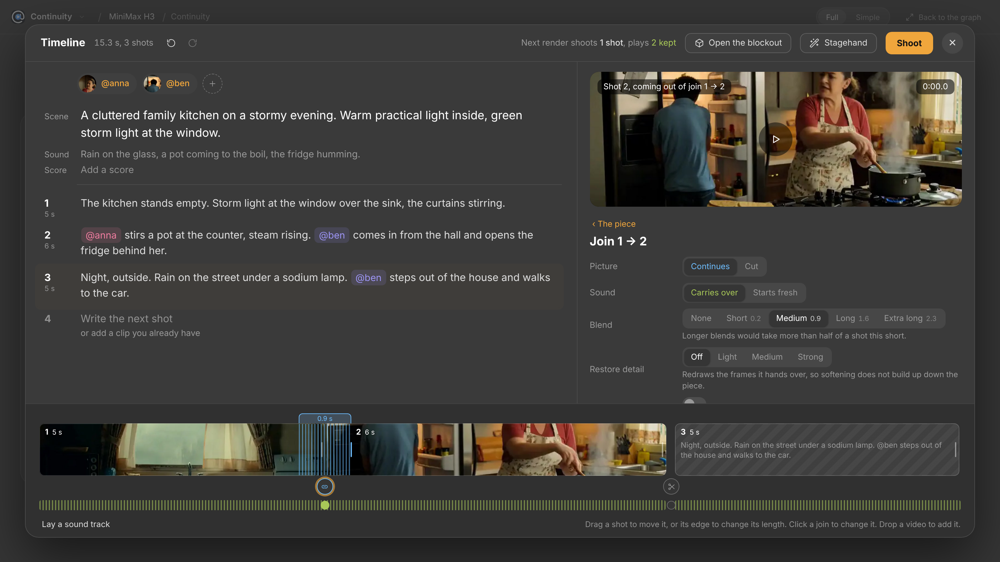
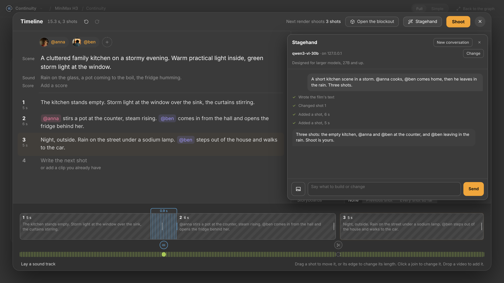
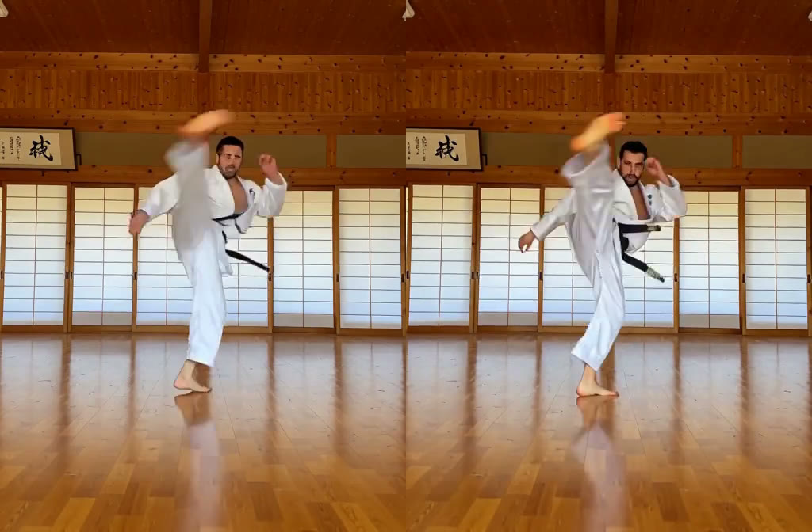
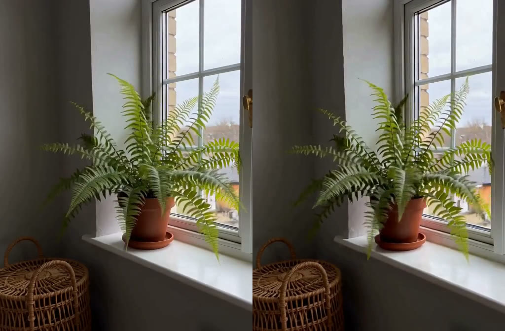

# Timelines

## Adding shots

Under the prompt there is a pill labeled **Add shot**. Click it and
the piece has two shots, the reel opens on the new one, and the node's face
becomes a timeline lane, proportional to the shots' durations. Delete back down to one shot and the
single-shot face comes back. There is no mode to switch.

Each shot is a whole generation with its own prompt, references,
LoRAs, and even its own family: a strip can be H3 throughout, or a pre-stage
on Krea 2 feeding start frames into shots on LTX 2.5.

## The reel

**Edit timeline** opens the reel: one window for writing, joining, watching and
reshooting the piece.

- **The header** says how long the piece is and what the next render will do
  (how many shots it shoots, how many kept takes it plays), and **Shoot**
  queues it. With nothing to shoot it reads **Put together**, which renders the
  kept takes and clips as they are ordered and trimmed now, and it goes away
  once the last film made is the piece as it stands. While a render
  runs it says which shot is being made and how far it is, with **Cancel**, and
  the player shows the preview; select a shot to watch its take instead, and
  click the header's line to go back. A failed render's reason is shown there too. The two arrows, or
  **Ctrl+Z** and **Ctrl+Shift+Z**, undo and redo any change made in the window
  since it was opened; a take that lands stays.
- **The script**, on the left. Above it, the cast and the piece's references
  as faces and frames; click one to see it, `+` to add someone or a file. Then
  the **scene**, the standing description every shot is written under (stored
  as the piece's `prompt`), with its **Sound** and **Score** as two lines under
  it. Then a paragraph per shot. Press **Enter** at the end of a shot to start
  the next one; **Shift+Enter** is a line break inside a shot, and
  **Backspace** in an empty shot takes it out again. The last line, *Write the
  next shot*, does the same, and *or add a clip you already have* cuts in
  footage. A shot with nothing in it offers the same, so a piece can start with
  a clip, and the gap above any shot has *Shot here* and *Clip here*. Drag a
  shot by its number to move it. `@` and `/` work everywhere they do elsewhere.
- **The side**, on the right: the player, and the inspector for whatever is
  selected. With nothing selected it shows the piece: model, frame,
  resolution, look (the piece's LoRAs), storyboards, how much sound a join
  carries, and the rewrite. A shot shows its take and what the next render
  does with it, its length, pictures, look, seed, motion fix and face. A join
  shows everything about that cut. A face or a frame shows who or what it is
  and which shots use it.
- **The reel**, underneath: the piece at its real length. Drag a shot or a
  clip to move it, here or onto the script; Escape puts it back. Drop a video
  file on it to cut it in there. Drag a shot's right
  edge to change its length. The circles between shots are the joins: click
  one to see it, and cut or continue it on the side. The thread under the shots
  is the sound, its dots show whether sound carries across, and a track you lay
  down sits on it. A continuing join with a blend has a bracket over it with
  its length, at its real width: blue ticks until both shots have a picture,
  then the next picture comes in through widening slits. Drag its right edge to
  change it.

Selecting a shot or a join anywhere selects it everywhere. Click the scene, its
Sound or Score, or *‹ The piece* on the side to get back to the piece's settings.

**Refine** under a selected shot, or on its side, rewrites that shot alone. Your
words stay in the script, dimmed, with a line saying the model reads a rewrite;
the rewrite is on the side to edit, switch off or revert. The other shots, the
scene, Sound and Score are not touched, so other kept takes stay unless they
continue from it.

Hover a face, a frame or a shot's picture for its ✕, or press Delete on a face
or frame. Out of the piece, a member's files go unless something else uses them,
their name stays in the text as a plain word, and a reference's mentions go with
it. Out of a shot, the shot's own file goes, while a member or reference of the
piece is only no longer named there. What the scene brings into every shot is
taken out of the scene. Some tools open as
their own sheets for now: the LoRA library, the file picker, a cast member's
full card, and a shot's rarer settings (*More for this shot*). See
`specs/continuity-reel-deep-tools-spec.md`.

## Stagehand

**Stagehand** in the reel's header opens a conversation over the inspector. Say
what the film is, who is in it and what the shots are, and it builds that on
the timeline while you watch: the film's text, its sound and music, the cast,
and the shots, each with its text, its length and the join in front of it. It
can add a shot anywhere, move one, change or remove one, set a join's picture
to continue or to cut and its sound to carry over or to start fresh, and
rewrite a cast member's description. It can find a LoRA in your library and
put it on the film, on one shot or on a cast member, or change or take off one
that is there, and put a look from the style library at the front of the film's
text or a shot's. It touches LoRAs and styles only when you ask it to. It never
renders: Shoot stays yours.

It builds nothing in 3D here. Ask it for a 3D scene, a blockout or a staged
shot and it opens the [blockout bench](tools.md#blockout-bench) on that shot and goes
on there with the bench's tools. That way is one way: the timeline's tools are
not the bench's, and **Open the timeline** brings you back when it is done.

The conversation is the piece's, so the reel and the bench show the same one,
and it is told where you are with each message. Everything else is as in the
bench: the model is the refiner's, a message can carry up to four pictures,
`@` lists the cast and the cast library, editing and Shoot wait while it works,
**Stop** ends it at once, and everything one message did is one Undo. See
[Stagehand](tools.md#stagehand) for the whole of it.

[A film of it](vid/timeline-blockout-stagehand.mp4) goes from an empty
timeline to a staged shot and back: a film written from a sentence, a shot
staged in the bench, the stage played and looked through, and the takes on the
reel. It is the real frontend driven by `tools/ui_harness/film.cjs`; the
model's replies are a script and the takes are stand-in stills.

## Passes

A pass is one generation. Most passes are one shot. **Render with shot N as
one pass**, on a join, compiles both shots into a single generation: no seam
at all, so music or dialogue carries across the cut, in exchange for one
checkpoint, one LoRA stack and one seed for the pass. The reel draws a bracket
over a pass of several shots, and the cut inside it has **Split into two
passes here**. A piece merged end to end is one pass, which is what one-pass
mode always was.

## Seeds

With nothing selected, the side has the piece's **Seed**: roll it, type one,
or keep it, and choose **One per shot** or **Same for every shot**. One per
shot, the default on a new piece, counts up from the piece's seed, the first
shot keeping it. A shot given a seed of its own always runs on that. Pieces
saved before the choice keep one seed for every shot. On a chained turbo piece
that can make a shot fall back to the ending of the one before.

## Seams

A seam can continue from any earlier segment's last frame, at
a single frame or as a blend that carries real motion and phase-locked sound
across the cut. How wide a blend can be depends on the family. Picture and
sound cross a cut independently: a hard cut whose score keeps playing, and a
match cut that resets the room tone, are both one switch away.

## Seams and drift

Every continued shot comes out a little brighter and a little harder than
the one it continues, and the next seam starts from that, so the change
walks down a strip. Measured on an 8-hop turbo strip, about three quarters
of it arrives as a step at each cut rather than inside the shots. Three
per-machine settings on the gear's Rendering tab act on it:

- **Turbo lead-in** (on by default, four steps). A turbo LoRA collapses the
  schedule, and the opening steps are where a shot is decided. This runs
  those steps on the base weights with the LoRA held off, then hands the
  rest of the same schedule to the distilled model. Measured: the step at
  each cut falls from +2.86 with it off to about +1.0 at four steps, and
  the texture ratchet falls with it. The cost is those four steps at the
  base weights' speed. Off is the old behaviour.
- **Seam handoff**. What a blended seam hands the next shot. *The latent*
  (default) slices the run off what the sampler made, so nothing is decoded
  and encoded again on the way. *Levelled* pulls that slice back to the
  first shot's tone before the model reads it. *Masked* writes the slice
  into the next shot's own latent and holds it there while the rest is
  sampled, so the model continues the frames it made rather than
  generating new ones under guidance; measured to remove the step at the
  cut on a single sampler, and about twice as fast, but not yet measured
  together with the lead-in. *The frames* is the road every render took
  before any of these, kept for comparison.
- **Seam restore** (per seam, on the blend pill). Re-draws the frames a
  seam hands over against the source shot's own references before the next
  shot continues from them. Helps on raw H3 with a good reference, hurts on
  turbo and low step counts. Off by default.

### The keystone

Experimental, and off by default. A fourth setting on the same tab, after
roycho87's [Geiru Context Suite](https://github.com/roycho87/geiru_context_suite):
the first shot of a scene is the only one made before any drift, so every
blended seam after it carries that shot forward as an anchor.

- **Keystone.** The scene's first latent — the cleanest frame it has — is held
  in the new shot's latent 0, beside the run the seam hands over, so every step
  attends to it. The shot's own latent 0 goes back before anything is decoded,
  so the keystone is never in a written frame.
- **Keystone + capstone.** Also the scene's last single frame, tacked onto the
  end of the shot for every model call from **Capstone joins at** (step 4 by
  default, counted on the whole schedule, lead-in included) and cut off again.
  The shot settles its own pose before it is shown the anchor. Raise the step
  if the motion stiffens, lower it if colour or detail starts to go.
- **Context noise** (ethanfel's): the carried run gets part of the sampler's
  current noise, all of it on its oldest frame fading to none at the join, so
  the model does not copy the drift it carries exactly. Full by default.
- **Keystone attention** (roycho87's, after ckinpdx's Carry Attention): on the
  13 blocks found to carry brightness (31–33, 36–44, 47), the keystone counts
  ×20 against the carried run when attention is shared out. Only the share
  those two split between them moves; the prompt, the references, the sound
  and the new frames keep exactly theirs. Measured there to hold a 30-clip
  chain's brightness to about −9 %, against −17 % for the keystone and
  capstone alone. Costs a little motion and about 5–10 % speed.

A hard cut starts a new scene, and its first shot becomes the next keystone.
The blend pill on a seam has a switch to take that one seam out, for a shot
that should leave the look behind. It needs the masked seam underneath it, so
a seam carrying a keystone takes the masked road whatever **Seam handoff**
says; on *The frames* nothing is handed as a latent and it stands down. It also
stands down on a seam whose scene started at another canvas.

Under Raylight the keystone and the noise travel in the latent; the capstone is
put on the workers' model for that one shot and taken off again. Keystone
attention is left out there — Raylight's parallel forward replaces core's
attention — and the log says so; everything else still carries.

roycho87 measured it on 10- to 50-clip chains of an 8-step turbo
([NerdNotes](https://github.com/roycho87/NerdNotes)): colour drift at clip 10
fell from 6.4 with no protection to 3.9 with the keystone and 2.9 with the
capstone added. Not yet measured here. Their own note: on a locked-off static
shot it holds the texture better than the colour, and the turbo LoRA matters.

None of this is zero yet. If you find a setting or a method that measures
better on your strips, open an issue with the per-cut numbers.

## Motion fix

H3 smears fast motion — a spinning kick, a sword arc, a whip-fast turn — into
a blur, and no seed or step count fixes it: one latent time token spans four
frames and cannot hold four different poses, so the poses were never drawn.
The **motion fix** chip on a card — on a lone shot, the pill of the same
name on its row — (H3 only, never on footage) runs a second pass after the
shot renders: the shot's own latent says where it moved too
fast, those frames are held on a longer clock at up to four copies each, the
slowed clip is sampled again from half the schedule against the shot's own
prompt and references, and the original clock is recovered by keeping the
first frame of every hold group — generated frames, never interpolated. Five
frames at either end are never held, are frozen through the second pass and
are put back verbatim, so the fix cannot become a seam step of its own; the
soundtrack rides through untouched. matlowai's Motion Lab worked the method
out; this is a reimplementation of its core.

The same frame of a 2 s turbo card at the same seed, plain on the left and
fixed on the right ([the clip](vid/motion-fix-burst.mp4)):

The kick keeps its choreography and gets its shin, foot and face back. On
this card the plan held 30 of 56 frames, slowed the clip to 124, and the
second pass cost about twice the card's own sampling time.

**The gate is the whole difference between a feature and a tax.** The same
pass over a calm shot comes back sharper and moving *wrongly* — the fern
below was re-drawn at 23 dB against the plain take and its stir no longer
reads as a draught. So a card is left alone unless its peak frame-to-frame
change, measured at thumbnail scale on 0–255, clears the gate: 4.4 on the
kick, 1.9 on the fern, gate at 2.5. The number is `motion_fix_abstain` on
the settings page; 0 fixes every card that asks, and the node writes what it
saw into the render history either way.

The same frame of a calm shot, plain on the left and forced through the
pass on the right — a still cannot show the motion going wrong, so
[the clip](vid/motion-fix-calm.mp4) is the one to watch:

Measured on two clips as of this page. A pan will clear the gate on motion
alone, and the fix has not been tried on one.

## Storyboards

A shot can be shown the shots before it. The **Storyboard** pill on the bar
has three answers: nothing, *each shot sees the shot before it*, or *each shot
sees the piece so far*. With one of the two on, every shot after the first is
handed a 3 × 3 sheet of frames from those shots — nine cells shared out by how
long each shot plays, in time order, reading left to right and top to bottom
— as its last picture reference, with a line in the prompt saying what the
sheet is, how it reads, and that the grid itself is never to be drawn. It is
the sheet people were attaching by hand (issue #43), made for you at render
time from the passes as they actually came out: a kept take is read from its
file, a cut-in clip from its window.

What it buys is the room. A cut to another angle of the same street has
nothing crossing it — no frame, no sound — and the model re-imagines the
street. With the sheet in front of it the walls, the light and where things
stand carry across. It is not a face reference: at the generation's own
canvas each cell is a ninth of the picture, enough for a place and not for a
likeness, which is what the cast is for.

The chip on every seam says what its own card sees — *sees #1–3*, *no
storyboard* — and opens to the same three answers plus a row of toggles, so
one card can see shots 1 and 4 while the piece is set to the shot before.
Under the toggles is a picture of the sheet with the number of the shot each
cell will come from, which is the one honest preview there is before the
shots exist.

Two costs. A shot shown a sheet is a reference generation, so it runs on the
reference checkpoint whatever else it carries, and the sheet takes one of the
nine picture slots — a card already citing nine is refused by name. And a
shot now depends on the shots it sees: edit shot 1 and every shot shown it
re-renders, where a hard cut used to keep its cache.

What was measured, on two scenes at three and eight shots, on turbo and on
the base weights: with the storyboard on, the place and its objects hold
across every hard cut — the same boat, crane and toolbox in all eight shots
where, without it, the same description gave a different boat in nearly
every one. The two settings hold the place equally well; *the piece so far*
is the one to reach for, because a shot's mistake then rides forward as one
cell among nine rather than as the whole sheet. On the tone drift described
above it changes nothing either way — the step at a continuation seam is the
same with it and without — and over eight hops it kept the picture's detail
where the strip without it softened.

The cost is composition. The sheet holds the camera as firmly as the room:
a shot written as a reverse angle or a close-up of the shots it sees comes
back framed like them. Some of that is the prompt's — a long standing
description ahead of a one-line shot gets framed as the description, sheet or
no sheet — but the sheet takes the rest of the variety with it. So for a shot
that needs an angle the earlier shots do not have, turn the storyboard off on
its seam chip, or show it only a shot that has that angle; the shots after it
can pick the strip back up.

Also measured and rejected: saying in the prompt that the sheet's framing is
not to be kept (no effect — the pull is in the picture), and handing the
frames over as a pooled video RefMod with the scene take instead of a sheet
(no effect on framing, and the pooled latent's colour stains compounded down
the chain). The sheet is a real picture, and that is why it stays one.

### How firmly the sheet holds

The prompt tells the model to keep where things stand in the sheet, and that
is also what undoes a change the shots themselves made: a table knocked over
in one shot stands back up in the next, because the sheet shows it standing.
Saying in the next shot's prompt that it lies broken only names the table
again. So the storyboard pill's popover has a second part, under the three
answers:

- **How firmly the sheet holds.** *Firm* is the default and what every piece
  before this setting had: the room, its light and where everything stands.
  *Partial* keeps the room and its light, and lets people and things move and
  change as the prompt says. *Loose* keeps only the broad look of the place and
  its light, and leaves the rest to the prompt, the camera included. In the
  prompt these are the guide's own retention markers, `fully_preserved`,
  `partially_preserved` and `weak_reference`. The sentence that defines the
  sheet changes with them, so it never claims more than the marker keeps.
- **What carries over.** The box shows the storyboard's line as the model reads
  it: the marker, then the sentence about what carries into the shot. It starts
  from the default wording for the hold, and you can rewrite it, for example to
  keep the room and its light but not where things stand. *Use the default*
  puts the wording back. Your line stays when you change the hold.

Both are settings of the piece, for every shot that is shown a sheet. They
change only the words, not the sheet itself, so they loosen what the model is
told to keep, not how strongly the picture pulls. Refine follows them too, so a
rewritten prompt keeps the hold you chose. A shot that is shown a sheet
re-renders when either changes.

### How firmly the sheet holds

The prompt tells the model to keep where things stand in the sheet, and that
is also what undoes a change the shots themselves made: a table knocked over
in one shot stands back up in the next, because the sheet shows it standing.
Saying in the next shot's prompt that it lies broken only names the table
again. So the storyboard pill's popover has a second part, under the three
answers:

- **How firmly the sheet holds.** *Firm* is the default and what every piece
  before this setting had: the room, its light and where everything stands.
  *Partial* keeps the room and its light, and lets people and things move and
  change as the prompt says. *Loose* keeps only the broad look of the place and
  its light, and leaves the rest to the prompt, the camera included. In the
  prompt these are the guide's own retention markers, `fully_preserved`,
  `partially_preserved` and `weak_reference`. The sentence that defines the
  sheet changes with them, so it never claims more than the marker keeps.
- **What carries over.** The box shows the storyboard's line as the model reads
  it: the marker, then the sentence about what carries into the shot. It starts
  from the default wording for the hold, and you can rewrite it, for example to
  keep the room and its light but not where things stand. *Use the default*
  puts the wording back. Your line stays when you change the hold.

Both are settings of the piece, for every shot that is shown a sheet. They
change only the words, not the sheet itself, so they loosen what the model is
told to keep, not how strongly the picture pulls. Refine follows them too, so a
rewritten prompt keeps the hold you chose. A shot that is shown a sheet
re-renders when either changes.

## Piece-level fields

The timeline itself carries:

- A **global prompt**: a standing description every segment inherits.
- **Piece references**: files attached to the piece rather than a card,
  addressed as `@ref-1`, `@ref-2`, and so on. Cite one in the global prompt
  and it rides into every segment; cite it in one card and it rides into that
  card alone.
- **Soundscape** and **music**: the two fields that describe the whole piece
  rather than one shot. A segment leaving them empty inherits them.
- **Global LoRAs**, merged in front of each segment's own.

## Kept takes and reshooting

Takes are kept by default. When a render brings a take back, the shot keeps
it, and the next render plays that take instead of shooting the shot again. So
the second render of a piece shoots only what changed. The bar says what the
next render will do: how many passes it shoots and how many kept takes it plays.

A kept take stops being kept when:

- **You change the shot.** Its words, length, seed, references or the join in
  front of it. The shot reads `Changed · reshoots`. Changes to the scene, the
  canvas or anything else every shot is made under change every shot.
- **You press Reshoot** on the shot's side.
- **What it was made from changes.** A move, an insert or a removal puts
  another shot in front of a shot that continues, changes the clip it runs
  into, or changes which shots share its pass.

Either way, the shots that **follow** it are reshot too: a shot that continues
from it across a join, or that is shown it on a storyboard sheet, was made from
film that is about to be replaced. A shot after a hard cut keeps its take. The
Reshoot button says beforehand which shots will follow.

A shot being reshot keeps its old take until the new one lands. **Keep this
take** puts it back, unless the shot it continues from is itself being reshot.
**Forget take** drops it from the shot; the file stays under `takes/`. If a
take's file has gone missing, the shot reads `File missing` and is shot again.

A kept take has *Trim* and *Crop* on its side, the same editors a clip has.
They change what plays, not the file: the render splices the window you
trimmed, framed as you cropped it, and the next seam continues from the end of
that window. A new take replaces the old one, and its trim and crop go with it.

### Locking a take

A kept take is let go by the smallest edit. When a take is the one you want
no matter what, **lock** it: the padlock at the end of the shot's line, or
**Lock take** on its side (**Lock this take** on a shot that already reads
`Changed · reshoots`). A locked take plays whatever changes:

- **Edits to the shot.** They stay on the shot, but nothing is shot until you
  unlock it. The shot reads `Locked, edit not shot`.
- **A new take of the shot it continues from.** The locked shot keeps the take
  that continued from the old film, so the cut into it may not line up. The
  shot reads `Locked, the cut may jump`, and unlocking it shoots it again from
  the new film.
- **Cards moving around.**

Shots that continue from a locked shot do not follow anything through it,
because the film they start from stays. **Forget take** and **Reshoot** need
the shot unlocked first. **Unlock** lets the usual rules apply again: a shot
you edited while it was locked goes back into the next render.

### Shooting only some shots

**Shoot only this shot** on a shot's side renders that shot and nothing else,
as a render of its own on the queue. On a shot that has a take, it reads
**Shoot a new take of this shot only**. A locked shot shot this way gets the
new take and stays locked.

To shoot several, Shift-click (or Ctrl/Cmd-click) them on the reel or by their
numbers in the script. They are numbered in the order you picked them, and
**Shoot N in this order** sends one render per shot in that order. **Lock
their takes** locks every picked shot that has one.

A shot that continues from a shot with no film yet cannot go alone: the frames
it starts from do not exist. So that shot goes first, in the same render, and
the button says so (`Shoot 4, then 5`). A shot that continues from a shot that
has a take starts from that take, even one due for a reshoot; it will be due
again once that shot has its new take.

A render of some shots writes the takes of those shots (and a short film of
them), not the piece. The next full **Shoot**, or **Put together** when
nothing is left to shoot, makes the piece.

Under the reel, **Queue** lists this node's renders in the order they will run.
A waiting one can be moved earlier or later, or taken off with ✕. ComfyUI's
queue cannot reorder, so a move takes the waiting renders off and sends them
again in the new order, each as it was first sent.

## Cutting in your own footage

A clip you already have can be a card on the strip, not just a reference. It
has a length, a place in the order and a seam on each side, and it compiles to
no generation at all: the finished piece simply contains it. Use it for
footage the piece should include as-is.

A written shot can be given a clip instead: select it and press **Use a clip**.
Its words stay on the clip and say what it shows; its take and its own
references and LoRAs go. **Generate it instead** makes the clip a shot again
from those words. The rewrite reads a clip's words when it writes the shots
beside it. The video model never does: a shot that continues from a clip is
given its frames, and being told the action too would make it play it again.

## While it renders

The progress display shows which segment is sampling ("Segment 2 of 5"), with
a live preview. Cached segments (unchanged since the last render) are skipped
by ComfyUI's own cache, so tweaking shot 4 doesn't re-render shots 1 through 3.
